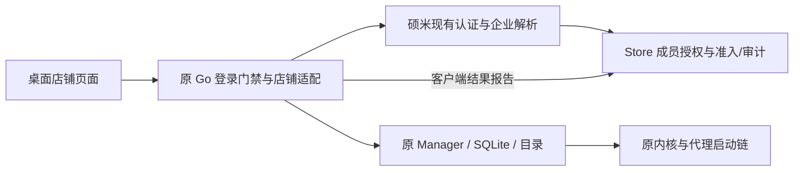

# 店铺工作台、店铺级授权与业务审计 v1

状态：**`IMPLEMENTATION_READY`（设计基线）**。授权/绑定/审计合同与 UI 增量已通过独立架构审阅；产品编码仍 `NOT_AUTHORIZED`，真实联调未验证。详见 [REVIEW](REVIEW.md)。这不是已实现 API、IAM 配置或运行验收。

## 1. 用户结果与授权范围

员工从已安装的浏览器登录硕米，选择当前企业及获授权店铺，首次配置自己的店铺环境，以后复用该实例打开和正常关闭；管理员沿用硕米现有入口分配店铺，并能查看店铺授权与浏览器操作记录。用户不运行脚本。

本轮产品依据为当前会话中用户批准的最小方案，以及 2026-10-25 的指令：“按这个最小范围把设计落到仓库文档，补齐授权、实例绑定和审计接口合同，完成架构审阅并明确实施任务与阻塞”；随后用户明确授权复用现有 Figma/浏览器页面补齐 UI 依据、更新就绪结论并提交设计文档 PR。本轮只允许设计文档、只读架构审阅及文档 PR；不修改产品代码、schema、IAM、运行配置，不运行产品、内核、真实登录、安装器、服务或部署，不合并 PR。后续实施仍须另有授权。

Design Basis 分类：**Independent Architecture**。现有 owner 全部复用，但新增跨系统授权、本机受管绑定和操作回执，不能归为纯 UI 接线。硕米的 [Architecture First 与审阅规则](https://github.com/qq550723504/shuomi-ai-commerce/blob/d8d30f6b0e8dfa903e02b002ef12f5747610c28f/AGENTS.md)适用于其服务端消费边界。

入口文档：[接口与持久化合同](CONTRACTS.md)、[UI 设计依据与桌面适配](UI.md)、[实施任务与验收](IMPLEMENTATION.md)、[架构审阅结论](REVIEW.md)。它们组成同一设计基线，不是独立产品需求。

## 2. 固定调查基线

| 仓库 | 固定版本 | 说明 |
| --- | --- | --- |
| 硕米 `qq550723504/shuomi-ai-commerce` | `d8d30f6b0e8dfa903e02b002ef12f5747610c28f` | 本轮只读远端 main 与本机 Git 对象；不触碰其他会话的工作树 |
| 浏览器 `qq550723504/openbrowser-platform` | main `32fafdee392dae08c61e459bd67aa7f3d4420cf7` | 本地 `ec88023c8f62105c0e3a45bf5f8be8ca28c121eb` 与其 tree 均为 `bb28f00d7d29bead6b1a03ddb92f117ed2295dc3`；文档分支以该等价源码树起步 |

调查不是产品验收。既有登录、安装与内核测试只证明其原有边界，不能证明本设计已实现。实施开始时只核对与本合同相关的变化，不因无关 main 移动重新做全部调查。

## 3. 已有能力、事实 owner 与复用路径

| 事实/能力 | 当前 owner 与证据 | 本次复用/适配 |
| --- | --- | --- |
| 已验证身份、有效企业、成员 ID | 硕米 `authruntime/zitadel`、`authidentity`、`workbenchcontext` | 复用现有 bearer 验证和实时企业解析；请求中的企业仅是选择值 |
| 企业角色与动作权限 | `internal/authz` 的 Casbin、企业角色/模块投影 | 增加一个默认不授予的应用能力；不新建 IAM、角色系统或组织目录 |
| 店铺及成员授权 | `internal/storecenter` 的 `MemberScopedStoreRepository` | 直接复用 Store→grant 锁顺序、成员授权、版本、原始授权回执 |
| 店铺列表/详情/资料 | 现有 Store catalog、profile 与 Console | 桌面消费精简投影；名称、分组、负责人、官方连接不复制成第二事实源 |
| 本机身份会话 | 浏览器 `internal/desktopauth`、`backend/auth_bound.go` | access token 仍只在 Go 内存；增加受限硕米 API 适配，不重新登录或建立另一认证核心 |
| 实例配置、SQLite、目录、启停与进程证明 | 原 `browser.Manager`、`ProfileDAO`、启动链和 `auth_cleanup.go` | 原 owner 内补原子受管创建和逐动作门禁；不复制 Manager、启动器或业务状态指针 |
| 内核、指纹、代理 | 原 core/proxy 管理 | 原路径、配置和连接栈；不自动切换 Xray+sing-box 与 Mihomo |
| 店铺审计与成员授权操作 | Store AuditRepository、member grant operations | 增加固定类型的浏览器事件和按店铺查询；原始事实仍由各 owner 保存 |

源码依据：

- [企业解析](https://github.com/qq550723504/shuomi-ai-commerce/blob/d8d30f6b0e8dfa903e02b002ef12f5747610c28f/internal/workbenchcontext/resolver.go)、[Store 当前身份适配](https://github.com/qq550723504/shuomi-ai-commerce/blob/d8d30f6b0e8dfa903e02b002ef12f5747610c28f/internal/app/httpapi/current_store_center.go#L107)、[成员店铺授权](https://github.com/qq550723504/shuomi-ai-commerce/blob/d8d30f6b0e8dfa903e02b002ef12f5747610c28f/internal/storecenter/member_access.go)。
- [企业角色](https://github.com/qq550723504/shuomi-ai-commerce/blob/d8d30f6b0e8dfa903e02b002ef12f5747610c28f/internal/authz/enterprise_roles.go)、[模块权限目录](https://github.com/qq550723504/shuomi-ai-commerce/blob/d8d30f6b0e8dfa903e02b002ef12f5747610c28f/internal/authz/module_catalog.go)、[现有成员店铺授权 UI](https://github.com/qq550723504/shuomi-ai-commerce/blob/d8d30f6b0e8dfa903e02b002ef12f5747610c28f/web/listingkit-ui/src/components/workbench/resources/member-store-dialog.tsx)。
- [Store 审计](https://github.com/qq550723504/shuomi-ai-commerce/blob/d8d30f6b0e8dfa903e02b002ef12f5747610c28f/internal/storecenter/audit.go)、[当前账户审计投影](https://github.com/qq550723504/shuomi-ai-commerce/blob/d8d30f6b0e8dfa903e02b002ef12f5747610c28f/internal/app/accountaudit/projection.go#L97)。账户审计当前未装配 Store/浏览器事件，不能声称已覆盖，也不把其 `source_account.read` 直接用于店铺审计。
- 浏览器 [登录边界](../mandatory-login/REQUIREMENTS.md)、[原生交付](../native-delivery/README.md)、[实例创建](../../backend/internal/browser/profile_create.go)、[实例持久化](../../backend/internal/browser/profile_dao.go)、[现有启停流程](../../frontend/src/modules/browser/pages/browserList/useBrowserProfileActions.ts)、[安全关闭](../../backend/auth_cleanup.go)。

## 4. 页面职责与用户路径

1. 复用现有登录页；Go 获取现有 workbench context，按其选择规则显示企业选择。切企业时重新解析权限，不继承前一个企业的选择、实例 DTO 或弹窗。
2. 桌面“我的店铺”只做查找和选择：当前企业、搜索、平台筛选、获授权店铺及真实状态。读取现有 catalog 的真实分页/总数，不先取全企业数据再在前端过滤。
3. 店铺详情只承接这一家店铺：店铺资料、本机环境、操作记录；主操作为“配置店铺环境”或“打开店铺环境”。首次配置进入复用的 BrowserEditPage 完整流程，不把配置长表单塞进列表。返回保持原筛选与位置；保存成功回到该店铺。
4. 再次打开复用原 profile；已在运行时只返回可核验的当前状态/聚焦原窗口，不重复启动。正常关闭走原停止链；撤权/注销后的关闭只走原有归属证明通道。
5. 授权管理继续使用硕米现有“成员店铺授权”对话框。桌面不提供组织、成员、角色或店铺 CRUD。店铺详情增加只读记录页签；不再造全局审计中心。

店铺记录、服务订阅、官方 API 连接、本机窗口四种状态分别展示。店铺停用/删除阻断新的环境操作；官方 API 未连接不等于无店铺权限，窗口启动不等于商家登录成功。此批不新增收费或续费准入规则。

硕米网页现有“进入店铺”继续跳转商品列表，不被桌面启动替换。负责人只表示业务归属，不能授予/撤销访问权。参见 [现有 Store 页面合同](https://github.com/qq550723504/shuomi-ai-commerce/blob/d8d30f6b0e8dfa903e02b002ef12f5747610c28f/docs/architecture/store-center-figma-v1.md#L18)。

现有页面的 Product Authority 是 [Figma `31:463` 与最终 UI/IA](https://github.com/qq550723504/shuomi-ai-commerce/blob/d8d30f6b0e8dfa903e02b002ef12f5747610c28f/docs/product/final-ui-ia-authority.md)，Store 映射见上述合同。初版未读取 Figma 因而保留 G2；本次已按用户的新授权只读核对可见节点、文字和截图，在 [UI.md](UI.md) 补齐三条完整流程的复用、桌面差异、字段、状态与交互依据。没有修改 Figma，不能将复用节点冒称新绘制的桌面成品页；该适配不反向改变领域 owner。

## 5. 边界与必要的架构补齐

现有 Profile 没有身份、企业和店铺绑定，现有登录门禁也没有 Store 动作权限。只加一个列表筛选会留下直接 API、后台动作、备份导出等绕过；新增受管边界必须覆盖它们。原 Create 是内存修改后逐条保存，不能“先 Create 再绑店铺”来假装原子创建，详见合同 C2。

保留一个 Manager、SQLite 连接 owner 和业务启动链；仅在其内部增加受管资料的事务入口与动作检查。服务器准入和本机进程启动不能组成单个数据库事务：Store 授权以服务端事务为准，本机结果单独记录；不承诺 IAM 撤销、浏览器进程和商家会话瞬时一致。

## 6. Threat Model、Must 与非目标

Must：防止通过正常应用、伪造 renderer 参数、直接 Wails/HTTP、旧后台任务和迟到响应跨身份/企业/店铺操作；令牌不得交给 renderer；授权必须先于实际副作用；原有数据保留；UNKNOWN 不自动重试；审计不夸大事实。

边界：本机 binding/profile/process 引用是客户端声明和本机运行事实，不是服务器证明的商家身份或防篡改设备身份。具有 OS 管理权、直接改 SQLite/EXE/浏览器目录的攻击者，以及用户在已打开商家窗口中的手工行为不在本版应用门禁/审计承诺内。不能据客户端上报收费、发布商品或宣称远端成功。

Out of Scope：跨设备/跨用户 Cookie 共享、历史实例接管、云档案、凭据托管、自动商家登录、自动化/RPA/CDP 新能力、远程控制、商家发布与资金操作、通用准入平台、消息队列、outbox/定时重报服务、新下载器或新 IAM。没有发现复用障碍前不引入新依赖；现有 ZITADEL/Casbin/Wails/SQLite 和浏览器管理足够承载本范围。

Legacy decision：**复用当前合格 owner，不消费硕米已退休的旧 browser 管理、tenantbridge 或 ListingKit 产品壳。** 历史浏览器数据保留但不接管、不迁移、不删除；未替代的原合格流程不退休。任何必须触及 legacy 的后续需求单独按硕米 EXTRACT/RETIRE 规则说明，不能从本文件推导兼容授权。

## 7. 设计状态

最终状态以 [REVIEW.md](REVIEW.md) 为准。`IMPLEMENTATION_READY` 只描述合同是否达到实施准入，不授予编码、真实运行、IAM、合并或部署权限。开发、离线回归、CI 和真实产品验收的证据必须分别记录；本轮除文档检查与架构审阅外均为 `NOT_RUN`。
